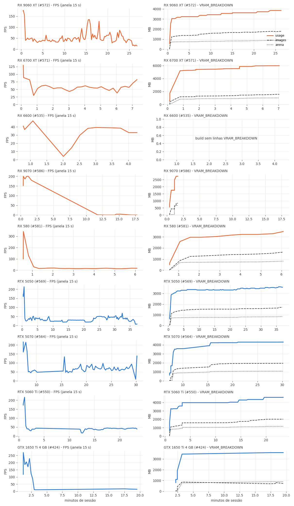
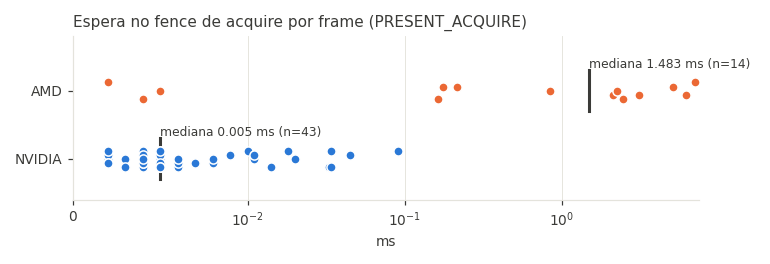
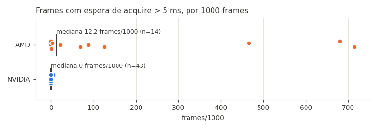
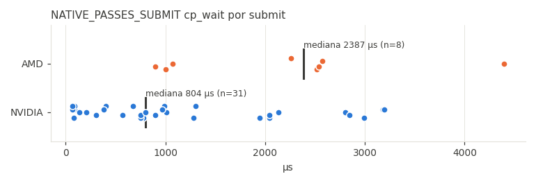
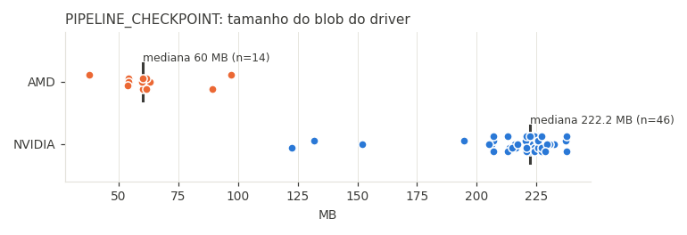
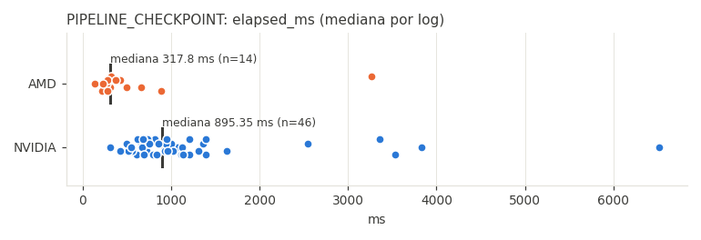

# Renderer v2 em placas AMD: análise dos logs (2026-10-24)

Base: issues de HayatoG/iss_pc criadas desde 2026-10-21. São 47 de AMD e 118 de NVIDIA. Em 43 delas havia log anexado, num total de 60 logs do renderer v2. Para responder à pergunta (c), entraram também as issues de crash AMD de 16 a 20/10 (#120, #123, #146, #252, #270, #280, #355, #357, #385). O código citado é o do branch `origin/fix/v2-amd-subgroup-stages` (PR #656, commit 7e29ce4). A pasta `./logs_locais` não existe.

Legenda: **[LOG]** = confirmado pelos logs · **[CÓDIGO]** = confirmado lendo o código · **[HIPÓTESE]** = falta teste A/B.

Arquivos nesta pasta: este relatório, os gráficos (`*.png`) e `METRICS_v2.csv`, com o resumo por log do v2 (FPS, VRAM, acquire, cp_wait, checkpoint). Os logs dos usuários, o índice das issues e as séries por log ficam fora do git: são dados pessoais. Os scripts de extração também ficam fora.

## Estado no PR #656

- **Feito:** fallback de present mode pela opção VSync (4.1, 80d7cc4); tamanho do blob em `PIPELINE_CHECKPOINT unavailable` e comentário de `requiredSubgroupSizeStages` corrigido (4.4, 4.5); opções só do renderer 1 marcadas e desabilitadas no launcher com o v2 (4.7, 7474be3).
- **Verificado, sem mudança:** os shaders gráficos não precisam de lowering wave64 (4.4). O deadlock do #586 é o bug de cond-wait já corrigido pelo #637 (8471638), que não estava nos builds dos logs (4.3).
- **Depende do A/B:** fence de acquire (4.1, item 2) e native passes na AMD (4.2).

## Resumo

| # | Achado | Status |
|---|---|---|
| 1 | No Windows, os drivers AMD não oferecem **Mailbox**. O v2 cai em **FIFO** e ainda bloqueia o thread de apresentação em `waitForFences` no acquire. No RDNA2 isso dá 2–7 ms por frame, com 47–72% dos frames esperando mais de 5 ms. Na NVIDIA a espera é de 0,005 ms. | [LOG] + [CÓDIGO]; o impacto no FPS é [HIPÓTESE] |
| 2 | `NATIVE_PASSES_SUBMIT cp_wait_us/submit`: a mediana é 2182 µs na AMD e 550 µs na NVIDIA. O command processor espera mais pelos workers de gravação. | [LOG]; a causa (custo de CPU do `vkCmd*` no amdvlk) é [HIPÓTESE] |
| 3 | A queda de FPS ao longo da sessão **não** acompanha VRAM: `arena_spilled` é 0 em todos os 60 logs, o GC não deleta nada nas placas AMD, e a VRAM fica bem abaixo do budget. | [LOG] |
| 4 | O "FPS cai pra 1–2" do #586 (RX 9070) é um **deadlock de mutex no guest** (job system/Wwise). O congelamento do #581 é um **I/O de `.xpps` parado**. Nenhum dos dois é GPU. | [LOG] |
| 5 | `PIPELINE_CHECKPOINT` **não** é problema na AMD: o blob tem 38–97 MB (contra 123–238 MB na NVIDIA), leva 318 ms de mediana, nunca passa de 256 MB e nunca derruba o FPS da janela. | [LOG] |
| 6 | Os crashes `amdvlk64.dll` +0x2063335, +0x2076d89, +0x221affa e +0xebbbb são **todos do renderer 1**. Nos logs do v2 há **0** faults em `amdvlk`. Nenhum log vem de um build com o #656. | [LOG] |
| 7 | O v2 já cria toda imagem 1D como 2D, então o BLOCK1D/BP09 já vem embutido nele. Portar `TLG_BLOCK1D`/`TLG_BC_TINY` pro v2 não tem respaldo nos logs, e `TLG_NO_MSAA` também não. | [CÓDIGO] + [LOG] |
| 8 | O texto do #656 diz que "a AMD lista só compute", o que é impreciso. O RDNA3/4 informa `requiredSubgroupSizeStages=0xf0` (fragment + compute + task + mesh), e o RDNA2/Polaris informa `0x20`. O fix por estágio continua correto. | [LOG] |

## 1. Logs coletados

A tabela abaixo traz os logs do v2 em AMD; os de NVIDIA estão em `METRICS_v2.csv`.

| Issue | GPU | Build | NP | Duração | FPS 1ºs 5 min → últimos 5 min (mín.) | VRAM máx. (arena) | Acquire média / >5 ms por 1000 frames | Sintoma relatado |
|---|---|---|---|---|---|---|---|---|
| 470 | RX 7800 XT | da39b0b | on | 7 min | 71 → 63 (44) | sem linhas | 0,16 ms / 0 | congelamentos aleatórios |
| 496 | RX 6700 XT | da39b0b | on | 6 min | 52 → 54 (38) | sem linhas | 2,13 ms / 69 | desempenho |
| 505 | 8060S (RADV, Linux) | da39b0b | off | 2 min | 46 (36) | sem linhas | 0,005 ms / 0 | crash (InputPlumber) |
| 533 | RX 6600 | da39b0b | off | 5 min | 32 (5,9) | sem linhas | **5,11 ms / 466** | v2 a 30 FPS |
| 535 | RX 6600 | da39b0b | on | 4 min | 33 (4,0) | sem linhas | **7,08 ms / 680** | v2 + native passes |
| 540 | RX 580 | cde38af | on | 1 min | 182 | 1,6 GB | 0 / 0 | crash (execução em endereço nulo) |
| 556 | RX 6750 XT | cde38af | on | 10 s | – | 1,7 GB | **6,16 ms / 715** | crash do probe (0x101) |
| 571 | RX 6700 XT | cde38af | on | 7 min | 55 → 56 (30) | 6,0 GB (1,0) | 2,26 ms / 87 | desempenho |
| 572 | RX 9060 XT | c8915d9 | off | 27 min | 47 → 43 (14) | 3,9 GB (0,9) | 0,18 ms / 2 | beta: FPS cai |
| 581 | RX 580 | c8915d9 | off | 6 min | 42 → 16 (14) | 3,5 GB (0,8) | 0 / 0 | baixo FPS e congelamento |
| 586 | RX 9070 | cde38af | off | 18 min | 191 → 1,9 | 2,7 GB (0,7) | 2,46 ms / 1 | congela no loading |
| 605 | RX 6750 XT | cde38af | on | 3 s | – | 4,2 GB | 3,09 ms / 126 | crash do probe (0x101) |
| 620 | RX 7800 XT | cde38af | on | 2 min | 88 (73) | 4,5 GB | 0,84 ms / 21 | congelamento |
| 629 | RX 7600 | da39b0b | on | 3 min | 88 (43) | sem linhas | 0,22 ms / 3 | desempenho |

Sobre os drivers: das 47 issues de AMD, 15 usam o compilador **LLPC** e 23 usam o **proprietary shader compiler**. Em 9 o campo não foi informado. Os logs não registram o compilador; ele só aparece no corpo da issue. Nenhum log registra a linha `unified_memory`, exceto o #505 (Linux).

Limites desta amostra: só 14 logs de AMD com v2 e só 3 sessões de AMD com mais de 15 minutos. Também faltam logs do #650 (9060 XT, "FPS drop to 25"), do #615 e do #587 (7800 XT), que só têm o resumo. Dá pra pedir esses logs aos usuários.

## 2. Gráficos









## 3. Respostas

### a) A queda de FPS acompanha arena, budget ou GC?

**Não nos logs de AMD. [LOG]**

- **#572 (RX 9060 XT, 27 min):** a usage vai de 3043 MB a 3851 MB, contra um `budget_now` de 15419 MB. A arena vai de 717 a 876 MB, e `arena_spilled` fica em 0 do início ao fim. `TEXTURE_GC deleted` fica em 0 do início ao fim. `TEXTURE_BUDGET_AUTO` fica estável entre 12,8 e 12,6 GB. O FPS oscila entre 30 e 60 conforme a cena, sobe a 110 no minuto 15 e cai a 17 no minuto 26. Esse último trecho não coincide com nenhuma mudança de VRAM:
  ```
  VRAM_BREAKDOWN usage=3851 MB budget_now=15419 MB images=1777 MB arena=876 MB arena_spilled=0 MB other=1196 MB critical=12103 MB
  TEXTURE_GC spared=0 deleted=0 streak_images=0 used=1777 MB trigger=8918 MB
  ```
- **#586 (RX 9070):** o FPS cai pra 1,9 depois de 11 min porque o jogo trava num mutex do guest. Segundo a análise do próprio usuário, o `JobWorker3` fica bloqueado em `scePthreadMutexLock`, num lock que o `JobWorker4` pegou e nunca soltou, e o main thread fica em spin esperando o job. Os últimos eventos são `GameState` + autosave + `.xpps` aberto e nunca fechado. Depois do minuto 1 não há mais linhas de VRAM, porque o GC não roda sem frames.
- **#581 (RX 580, 8 GB):** o FPS fica em ~16 desde o minuto 1, com a VRAM a 3,5 GB de 6,4 GB e spill 0. O `FREEZE` mostra o guest `SceFiosIO` parado em `waiting on file read '/app0/art/cache/b514.xpps' for 10109 ms`. Ou seja, I/O, não GPU.
- **NVIDIA:** só houve pressão real de VRAM na **GTX 1650 Ti de 4 GB (#424)**: `usage=3590 MB` contra `budget_now=3349 MB`, com 55872 texturas deletadas e FPS de 11–15. Nas demais NVIDIA (5050, 5060 Ti, 5070) a VRAM é igual à da AMD (3,3–4,6 GB, spill 0).
- **Correlação Pearson entre FPS e as métricas (janelas de 15 s, `corr.py`):** usage e arena dão de −0,5 a −0,9 **nos dois fabricantes**. Isso vem do menu e do loading, que têm FPS alto e pouca VRAM, então não indica causa. Com `FAULT_WINDOW faults` a correlação fica entre −0,4 e −0,86, também nos dois fabricantes.

O mecanismo de "a arena cresce, o budget encolhe, o GC entra em churn" está no código (`texture_cache.cpp:125` e `:133`), mas **não aparece** em nenhum log de AMD. Só ocorre em placas de 4 GB.

### b) PIPELINE_CHECKPOINT

**[LOG]** Mediana por log (`METRICS_v2.csv`, nesta pasta):

| | Blob | elapsed_ms | Logs |
|---|---|---|---|
| AMD | **60 MB** (38–97) | **318** (139–3260) | 14 |
| NVIDIA | 222 MB (123–238) | 895 (311–6516) | 46 |

- Nenhum blob passa de 256 MB, e não há `PIPELINE_CHECKPOINT unavailable` nem `snapshot unavailable` em nenhum log. A hipótese de que "o blob da AMD é maior" está **refutada**: ele é cerca de 3,7× menor.
- O checkpoint só escreve, e só loga, quando o hash muda (`pipeline_checkpoint.cpp:26`). Por isso, na AMD quase todos os logs têm um único checkpoint, no início da sessão.
- Engasgos: em 12 checkpoints durante o jogo na AMD, o FPS da janela ficou em 1,12× o das janelas vizinhas (mínimo 0,84×), e nenhuma janela ficou abaixo de 0,8×. Na NVIDIA, 11 de 105 janelas ficaram abaixo de 0,8×, mas esse checkpoint só roda quando houve compilação nova, então o efeito se confunde com a própria compilação. **Na AMD, o checkpoint a cada 30 s não explica os engasgos.**

### c) Crashes em `amdvlk64.dll`

**[LOG]** Todos são do **renderer 1**. Dá pra ver pelo formato do log (`GPU [Render.Vulkan] <Warning> image_info.cpp`, `GPU trace:`) e pelos builds de 16 a 20/10.

| Offset | Issues | GPUs | Fase / o que veio antes |
|---|---|---|---|
| +0x2063335 | #120, #252, #280, #355, #357 | 7600, 7700 XT, 9070 XT | Logo depois de **criar a imagem BC 512×1, 32 camadas, 10 mips** (já decodificada em CPU pelo `TLG_BC_TINY` → `R8G8B8A8Srgb`, tile `Thin1DThin`). Não é criação de pipeline. |
| +0x2076d89 | #123, #146, #270 | 7800 XT, 9070 XT, 890M | A mesma imagem 1D 512×1 (`created 1D image` → fault). No #270, 3 de 4 logs caem durante o precompile. |
| +0x221affa | #586 (log de v1) | 9070 | **Precompile** em 15 threads, logo depois de `Compiling cs shader 0xc73d977b` (pipeline de compute). |
| +0xebbbb | #603, #385, #525, #627, #655 | RX 470/570/580, Vega/APU | Escrita em NULL **dentro de `pipelineBarrier2`** com mais de 9.200 barriers num só call (#603). No #385, logo depois de `SetBackingSamples`. |

Trecho do #355 (renderer 1, RX 9070 XT):
```
ImageInfo: tlg: BC image 512x1 Bc1RgbaSrgbBlock type 12 tile Thin1DThin layers 32 mips 10 at 0x10f948a000 -> R8G8B8A8Srgb (CPU decode, TLG_BC_TINY)
GPU trace: create thin image 512x1 layers 32 mips 10 R8G8B8A8Srgb vk type 1D ...
GPU trace: created thin image 0000000140F4B420
Fault: read access to 0000000815fe0f08 at amdvlk64.dll+0x2063335 (thread 21792)
  rax=0000000000000000 rbx=0000000000000000 rcx=00000000fffffffd rdx=0000000015fe0f20
```
Os registradores (`rcx=fffffffd`, endereço `0x8…f08`) são os mesmos no +0x2076d89 e no +0x221affa. Provavelmente é o mesmo bug em versões diferentes do driver, 26.8.1 e 26.9.2 [HIPÓTESE].

Nos logs do v2 de AMD, desde 21/10, há **0 faults em `amdvlk`**. Os faults de v2 em AMD são `tlg-probe-v2.exe+0x177b4e` e `+0x17f73e` (leitura de `0x101`, ao abrir o menu Performance), que aparecem **igual na NVIDIA** (#502, RTX 2060 SUPER), e uma execução em endereço nulo (#540, RX 580, native passes on).

**Algum log com o fix do #656?** Não. Os builds presentes são cde38af, da39b0b, c8915d9, 88e912f, b4ff25d, 4000f78 e outros mais antigos, e nenhum deles contém o 7e29ce4 (`git merge-base --is-ancestor`).

### d) O que mais diferencia AMD de NVIDIA

1. **Espera no fence de acquire [LOG]:** a mediana é 1,48 ms na AMD e 0,005 ms na NVIDIA. No RDNA2 (6600, 6700 XT, 6750 XT), fica em 2–7 ms por frame, com 466–715 frames por 1000 acima de 5 ms. O Polaris (RX 580) e o RADV ficam em ~0. Trecho do #571 (6700 XT):
   ```
   FindPresentMode: Requested present mode Mailbox is not supported, falling back to Fifo.
   PRESENT_ACQUIRE fence=1 count=2001 call_ms=0.084 fence_avg_ms=4.190 fence_max_ms=21.603 over1=1878 over5=619 over10=9
   ```
   Todos os logs de AMD no Windows têm a linha "Mailbox is not supported, falling back to Fifo". Nenhum log de NVIDIA tem.
2. **`cp_wait_us/submit` [LOG]:** a mediana é 2182 µs na AMD (8 logs) e 550 µs na NVIDIA (31 logs). Os CPUs variam, então a comparação é ruidosa.
3. **Compilação [LOG]:** não há diferença. O AOT terminou em 0,15 s (AMD) e 0,10 s (NVIDIA), com tudo já em cache. O preload de pipelines levou 2,0 s e 2,6 s. O número de compilações durante o jogo é parecido (de 0 a ~300).
4. **Readback e host copies:** `VRAM_OTHER readback=0 MB` em todos os logs. Não apareceu custo de readback diferente.
5. **GPU idle:** o v2 não loga ocupação da GPU, então não dá pra medir.

## 4. Código e correções propostas (em ordem de impacto)

### 4.1 Present mode e fence de acquire na AMD (alto impacto, [CÓDIGO] + [LOG])

`port/gpu_v2/gpu/overrides/vk_swapchain.cpp`:
- `Swapchain::FindPresentMode()` (l. 407–438): pede `EmulatorSettings.GetPresentMode()`, que é `BB_PRESENT_MODE` com padrão `"Mailbox"` (`gpu/shim/core/emulator_settings.h:26`). Quando o modo não existe, o fallback é **sempre `eFifo`**, ou seja, vsync. Além disso, a linha 148 força FIFO em tela cheia exclusiva.
- `Swapchain::AcquireNextImage()` (~l. 266–300): com `ISS_PRESENT_ACQUIRE_FENCE` ligado (o padrão), faz `waitForFences(acquire_fence, …, UINT64_MAX)` na CPU logo depois de cada `acquireNextImageKHR`. Esse fence foi calibrado na NVIDIA a 75 Hz. Com FIFO na AMD, ele espera o presentation engine devolver a imagem.

Proposta:
1. Na falta de Mailbox, cair pra **`eImmediate`** quando ele existir (a AMD no Windows oferece) e quando o usuário não tiver pedido vsync, em vez de FIFO. Deixar FIFO só como último recurso, e logar a escolha.
2. Desligar o fence de acquire por padrão quando o modo efetivo for FIFO, ou só em AMD. Outra opção é usar um timeout curto e seguir com o semáforo.
3. Testar `image_count = minImageCount + 2` em FIFO (l. 454).

### 4.2 Espera do command processor nos native passes ([LOG] para a diferença, [HIPÓTESE] para a causa)

`port/gpu_v2/gpu/native_passes.cpp`: `WaitJob()` (l. 1303) e `WaitRecorded()` medem o tempo em que o CP espera o worker gravar o job. Na AMD essa espera é 4× maior. Antes de mexer no código, vale o A/B com `ISS_NATIVE_PASSES=0` (o #572 e o #586 já rodam com NP off). Se o ganho se confirmar, a proposta é recomendar NP off em AMD no `hardware.py` ou subir o número de workers de gravação quando o vendor for AMD.

### 4.3 Deadlock do guest (#586) e I/O de `.xpps` (#581) (alto impacto em congelamentos, independe do fabricante, [LOG])

Fogem do escopo AMD, mas explicam os relatos de "congela no loading" de 7800 XT e 9070. O próximo passo é investigar o caminho de `scePthreadMutexLock` usado pelo job system e pelo Wwise (o lock em `0x800803e90`/`0x800803f80` no eboot 1.07) e o retorno das leituras de `SceFios` que nunca completam.

### 4.4 PR #656: subgroup size (baixo impacto no FPS, corrige uso inválido da API, [CÓDIGO] + [LOG])

O fix por estágio (`vk_graphics_pipeline.cpp:325`, `IsRequiredSubgroupSize64ValidFor`) está correto para os valores reais:

| Família | requiredSubgroupSizeStages | Efeito do fix |
|---|---|---|
| RDNA3/4 (7600, 7800 XT, 9070) | `0xf0` (FS, CS, TS, MS) | VS sem o struct; FS mantém wave64 |
| RDNA2, Polaris (6700 XT, RX 580) | `0x20` (CS) | VS e FS sem o struct |
| NVIDIA | `0x3fff` | nada muda (max 32, não entra) |
| APU AMD (#591) | `0xff` | VS e FS mantêm |

Ajustes:
- Corrigir o comentário em `vk_instance.h:278` e o texto do PR, que dizem "AMD lista só compute".
- **[HIPÓTESE]** Os módulos são SPIR-V 1.6 (`supported_spirv = SpirvVersion1_6`). Sem o struct, o subgroup size do VS no RDNA3/4, e do VS/FS no RDNA2, pode variar entre wave32 e wave64. Se algum vertex ou fragment shader traduzido usar operações de wave (ballot, readlane) assumindo 64 lanes, o resultado sai errado. Antes de fazer o merge, vale conferir se o recompilador emite operações de subgroup fora de compute.

### 4.5 Checkpoint do cache de pipelines: não mexer agora ([LOG])

`pipeline_checkpoint.cpp` (l. 14–37) e `bridge.cpp:622` não mostram problema na AMD. Só a NVIDIA chega a 238 MB, perto do limite de 256 MB (l. 23). Se o limite passar a ser atingido, a linha `unavailable` deveria logar o tamanho, que hoje não loga.

### 4.6 GC e arena: não é a causa na AMD ([LOG])

O mecanismo existe (`texture_cache.cpp:125`, `:133`; `buffer_cache.cpp:706` `ISS_ARENA_SPILL`), mas só se manifesta em placas de 4 GB (#424, NVIDIA). Não há mudança proposta para a AMD.

### 4.7 Portar `TLG_NO_MSAA`, `TLG_BLOCK1D` e `TLG_BC_TINY` para o v2?

**Não vale.** Os três contornos atacavam crashes do v1 com imagens 1D, BC e MSAA (+0x2063335, +0x2076d89, +0xebbbb), e no v1 o +0x2063335 continuou acontecendo **mesmo com o `TLG_BC_TINY` ativo**. O v2 já resolve a raiz do problema: `ConvertImageType()` em `port/gpu_v2/gpu/overrides/image.cpp:57` mapeia `Color1D` e `Color1DArray` para `vk::ImageType::e2D`, que é o efeito do BLOCK1D/BP09. Nos 14 logs de AMD com v2, com texturas BC4/5/6H/1 e tiles `Thin1DThin` em uso, há **0** faults em `amdvlk`. O que vale fazer é **tirar do launcher** essas opções quando o renderer for v2, já que hoje elas aparecem como "Automático: ligado na AMD" e não fazem nada nele.

## 5. Testes A/B para usuários AMD

Cada teste usa o mesmo save, a mesma rota (ex.: andar 5 min pelo centro) e 2 runs de cada lado. É preciso mandar o `run-*.log` inteiro.

| # | Variável | Mede | Espera-se se a hipótese valer |
|---|---|---|---|
| 1 | `BB_PRESENT_MODE=Immediate` × padrão | FPS, `PRESENT_ACQUIRE fence_avg_ms`, `FindPresentMode` | No RDNA2, espera de acquire perto de 0 e FPS maior. Tearing é esperado. |
| 2 | `ISS_PRESENT_ACQUIRE_FENCE=0` × padrão | os mesmos | A espera sai do fence. O FPS sobe se a espera estiver no caminho crítico. |
| 3 | `ISS_NATIVE_PASSES=0` × padrão | FPS, `cp_wait_us/submit` | FPS igual ou maior na AMD |
| 4 | Janela sem borda × tela cheia exclusiva | FPS | Exclusiva força FIFO (l. 148) |
| 5 | `ISS_PIPELINE_CHECKPOINT=0` × padrão | engasgos a cada 30 s | **Nenhuma diferença** (controle) |
| 6 | `ISS_GC_BUDGET_MB=auto` × 8000 | `TEXTURE_GC deleted`, FPS | Nenhuma diferença em placas de 8 GB ou mais (controle) |
| 7 | `ISS_ARENA_SPILL=0` × padrão | `arena_spilled` | Nenhuma diferença, já que o spill é 0 (controle) |
| 8 | Build do PR #656 (CI) × v2026.10.22 | crashes na compilação, artefatos visuais | Sem regressão visual no RDNA2/3. Conferir água, fumaça e partículas. |

Pra ter mais dados, os relatos devem incluir, além do log: o modelo do monitor e a taxa de atualização, se o FreeSync está ligado, se o modo é janela, sem borda ou tela cheia, e a versão do Adrenalin.
